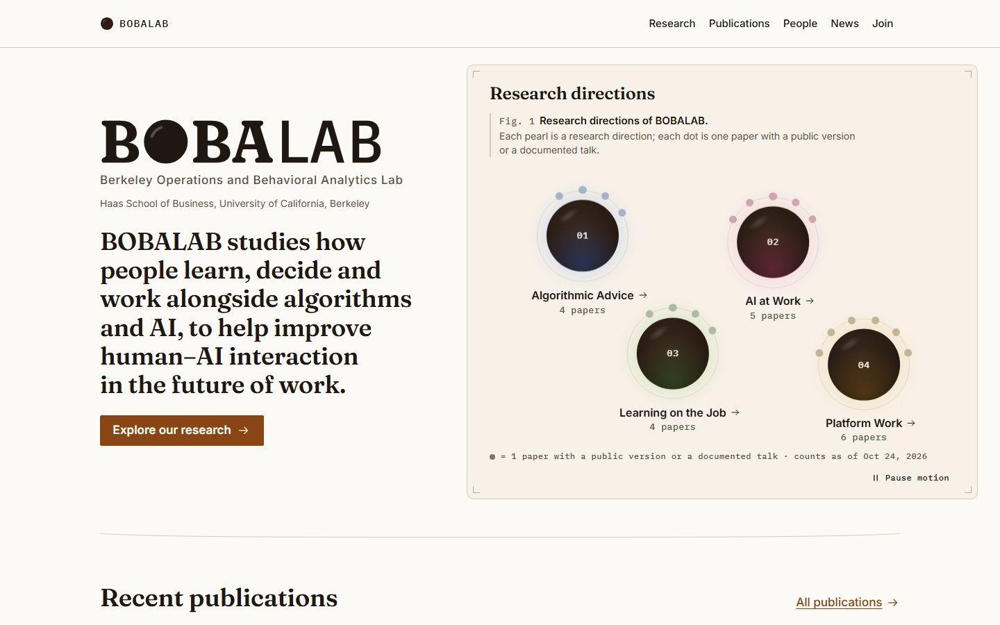

# Visual audit: why the BOBALAB site reads as AI-generated, and what is good

- **Audited:** the live site https://bobalabx.github.io/bobalab-web/ (branch `redesign` build), 2026-10-24.
- **Prompt:** Prof. Park's feedback that "the design kinda looks like it is AI generated".
- **Lens:** an art director who has seen hundreds of 2025–2026 AI-built sites.
- **Labels:**
  - **MEASURED:** seen in a screenshot or measured in the DOM.
  - **DOCUMENTED:** a source URL is given.
  - **HYPOTHESIS:** judgement or inference.

**Method.** Playwright Chromium (headless) captured:
- 14 templates at 1440×900 and 390×844, in light and dark (`colorScheme`). The shots are full-page JPEGs at quality 80, saved as `.jpg`, not `.png`, because they are JPEG data.
- Fig. 1 at rest, on hover, and in the middle of the intro. The intro frames are deterministic: every `document.getAnimations()` is paused and seeked to *t*.
- One frame frozen 200 ms into the pearl → direction morph.
- The first screen of the key mobile pages at DSF 2.
- Four 2× detail crops.

A DOM pass then counted pills, bordered boxes, mono text nodes, fonts and arrow links on 10 templates. The scripts and raw numbers live in the scratchpad, outside the repo (`…/scratchpad/redesign/tools/capture.js`, `fig1.js`, `measure.json`). I looked at every image cited below.

---

## 0. Verdict in one paragraph

The site does not look AI-generated because of any single mistake. The **hero figure** is original. **Everything around it** is built from the 2025–2026 "warm editorial" kit:
- a cream page with a terracotta/brown accent;
- a high-contrast serif for headings over Inter body text, plus a monospace face for small labels;
- tracked all-caps mono eyebrows;
- uniform 10 px-radius bordered white cards;
- outlined pill badges on almost every item;
- "→" on every link;
- every section shaped the same way: h2, then "All X →", then a hairline, then a list or grid.

Design writers now name these traits as the *second wave* of AI design tells, the look AI tools produce once purple gradients are banned (DOCUMENTED: [capitalandcompute.net, "How to Fix AI Slop in Web Design, Tell by Tell"](https://capitalandcompute.net/blog/fix-ai-slop-design/). Its "warm editorial" cluster is cream + serif display + terracotta, and its "template chrome" cluster is tracked eyebrow labels, "A · B · C" meta strings, a monospace face for small labels, arrows on every link, and 01/02/03 markers. Inter as the unchosen default is also in [925studios, "AI Slop Fonts and Gradients"](https://www.925studios.co/blog/ai-slop-design-tells)). BOBALAB has **every item in both clusters**.

The copy adds a second tell. Public pages carry the build pipeline's own caveats ("reported by the lab" ×15 on /publications/, "Status not confirmed" ×4 on /join/, "listed by title only", "This direction collects…"), and that reads like machine-written scaffolding.

The signature, Fig. 1, appears on **one** page. The other 13 templates never use its visual language. The site is a distinctive figure bolted onto a stock template.

---

## 1. Screenshot index (`before/`)

| Template | Desktop 1440 (light / dark) | Mobile 390 (light / dark) | Extra |
|---|---|---|---|
| Home | [L](before/home-1440-light.jpg) · [D](before/home-1440-dark.jpg) | [L](before/home-390-light.jpg) · [D](before/home-390-dark.jpg) | fold: [1440 L](before/home-fold-1440-light.jpg) · [1440 D](before/home-fold-1440-dark.jpg) · [390 L](before/home-fold-390-light.jpg) · [390 D](before/home-fold-390-dark.jpg) · [390 screen 2 L](before/home-fold2-390-light.jpg) · [D](before/home-fold2-390-dark.jpg) |
| Fig. 1 states | rest [L](before/fig1-rest-1440-light.jpg) · [D](before/fig1-rest-1440-dark.jpg); hover 02 [L](before/fig1-hover-02-1440-light.jpg) · [D](before/fig1-hover-02-1440-dark.jpg) | — | intro 150/400/700 ms: [L150](before/fig1-intro-150ms-1440-light.jpg) · [L400](before/fig1-intro-400ms-1440-light.jpg) · [L700](before/fig1-intro-700ms-1440-light.jpg) · [D150](before/fig1-intro-150ms-1440-dark.jpg) · [D400](before/fig1-intro-400ms-1440-dark.jpg) · [D700](before/fig1-intro-700ms-1440-dark.jpg); morph 200 ms [L](before/morph-200ms-1440-light.jpg) · [D](before/morph-200ms-1440-dark.jpg) |
| /research/ | [L](before/research-1440-light.jpg) · [D](before/research-1440-dark.jpg) | [L](before/research-390-light.jpg) · [D](before/research-390-dark.jpg) | fold [L](before/research-fold-390-light.jpg) · [D](before/research-fold-390-dark.jpg) |
| Direction (/research/ai-at-work/) | [L](before/direction-ai-at-work-1440-light.jpg) · [D](before/direction-ai-at-work-1440-dark.jpg) | [L](before/direction-ai-at-work-390-light.jpg) · [D](before/direction-ai-at-work-390-dark.jpg) | after morph (algorithmic-advice) [L](before/direction-fold-1440-light.jpg) · [D](before/direction-fold-1440-dark.jpg); mobile fold [L](before/direction-ai-at-work-fold-390-light.jpg) · [D](before/direction-ai-at-work-fold-390-dark.jpg) |
| /projects/ | [L](before/projects-1440-light.jpg) · [D](before/projects-1440-dark.jpg) | [L](before/projects-390-light.jpg) · [D](before/projects-390-dark.jpg) | |
| Project (learning-to-gig) | [L](before/project-learning-to-gig-1440-light.jpg) · [D](before/project-learning-to-gig-1440-dark.jpg) | [L](before/project-learning-to-gig-390-light.jpg) · [D](before/project-learning-to-gig-390-dark.jpg) | |
| /publications/ | [L](before/publications-1440-light.jpg) · [D](before/publications-1440-dark.jpg) | [L](before/publications-390-light.jpg) · [D](before/publications-390-dark.jpg) | fold [L](before/publications-fold-390-light.jpg) · [D](before/publications-fold-390-dark.jpg) |
| Paper (deng-2025-learning-to-gig) | [L](before/paper-deng-2025-learning-to-gig-1440-light.jpg) · [D](before/paper-deng-2025-learning-to-gig-1440-dark.jpg) | [L](before/paper-deng-2025-learning-to-gig-390-light.jpg) · [D](before/paper-deng-2025-learning-to-gig-390-dark.jpg) | |
| /people/ | [L](before/people-1440-light.jpg) · [D](before/people-1440-dark.jpg) | [L](before/people-390-light.jpg) · [D](before/people-390-dark.jpg) | fold [L](before/people-fold-390-light.jpg) · [D](before/people-fold-390-dark.jpg) |
| Person (park-sinchaisri) | [L](before/person-park-sinchaisri-1440-light.jpg) · [D](before/person-park-sinchaisri-1440-dark.jpg) | [L](before/person-park-sinchaisri-390-light.jpg) · [D](before/person-park-sinchaisri-390-dark.jpg) | |
| /news/ | [L](before/news-1440-light.jpg) · [D](before/news-1440-dark.jpg) | [L](before/news-390-light.jpg) · [D](before/news-390-dark.jpg) | |
| News item (msom-three-papers) | [L](before/news-item-msom-three-papers-1440-light.jpg) · [D](before/news-item-msom-three-papers-1440-dark.jpg) | [L](before/news-item-msom-three-papers-390-light.jpg) · [D](before/news-item-msom-three-papers-390-dark.jpg) | |
| /join/ | [L](before/join-1440-light.jpg) · [D](before/join-1440-dark.jpg) | [L](before/join-390-light.jpg) · [D](before/join-390-dark.jpg) | |
| /about/ | [L](before/about-1440-light.jpg) · [D](before/about-1440-dark.jpg) | [L](before/about-390-light.jpg) · [D](before/about-390-dark.jpg) | |
| 404 | [L](before/404-1440-light.jpg) · [D](before/404-1440-dark.jpg) | [L](before/404-390-light.jpg) · [D](before/404-390-dark.jpg) | |
| Footer | [L](before/footer-1440-light.jpg) · [D](before/footer-1440-dark.jpg) | [L](before/footer-390-light.jpg) · [D](before/footer-390-dark.jpg) | |

**Detail crops (2×):**
- [detail-pub-entry.jpg](before/detail-pub-entry.jpg): a publication row.
- [detail-direction-cards.jpg](before/detail-direction-cards.jpg): direction cards on /research/.
- [detail-project-cards.jpg](before/detail-project-cards.jpg): project cards with empty bodies.
- [detail-join-status.jpg](before/detail-join-status.jpg): "Status not confirmed" cards.

---

## 2. Measured surface counts (DOM pass, 1440 light)

| Template | Outlined pills¹ | Bordered rounded boxes² (radius) | Mono text nodes | Text nodes in Inter / Fraunces / Plex Mono | `` in main |
|---|---|---|---|---|---|
| Home | 8 | 6 (10 px; 50% avatars) | 28 | 119 / 8 / 28 | 10 (headshots) |
| /research/ | 2 | 6 (10 px) | 12 | 57 / 10 / 12 | 0 |
| Direction | 10 | 4 | 19 | 88 / 5 / 19 | 0 |
| /projects/ | 21 | **17** (10 px) | 18 | 58 / 24 / 18 | 0 |
| /publications/ | **46** | 0 | **93** | 285 / 8 / 93 | 0 |
| /people/ | 5 | **29** (10 px) | 14 | 169 / 35 / 14 | 21 |
| /news/ | 23 | 0 | 27 | 95 / 1 / 27 | 0 |
| /join/ | 8 | 5 (10 px) | 1 | 59 / 4 / 1 | 0 |
| Paper page | 5 | 3 | 22 | 66 / 7 / 22 | 0 |

¹ A bordered element under 48 px tall whose radius is at least half its height. ² A bordered solid box over 60 px tall with a radius above 0. All MEASURED.

- **Not one research image** (figure, chart, photo of a study or the lab) appears on any template. The only images on the site are the student headshots, on /people/ and the home People strip. The PI has none: he is shown as "PS" initials (MEASURED).
- **Copy-pattern counts** come from the server HTML (MEASURED):
  - "reported by the lab": 15× on /publications/, 3× on home, 3× on each direction page.
  - "as of Oct 20, 2026": 8× on /publications/.
  - "Status not confirmed": 4× on /join/.
  - "More information": 4× on /join/.
  - "listed by title only": on every direction page.
  - The mission sentence ("…learn, decide and work alongside algorithms and AI…") appears on home, appears again on /about/, and is paraphrased a third time on /about/.

---

## 3. Inventory of AI tells (each with evidence)

Each row gives: the tell, the evidence (file + element + what I saw), whether it is true of this site, and impact × effort. Impact is how much the tell drives the "AI-made" read. Effort is S (hours, CSS or copy only), M (a day or two, component changes plus test updates) or L (several days or new assets).

### 3.1 Typography

| # | Tell | Evidence | Verdict | Impact × Effort |
|---|---|---|---|---|
| T1 | **The "serif display + Inter + mono labels" trio.** This is the canonical 2025–26 editorial-AI stack | Every h1/h2 is set in Fraunces 600. Body and UI text is Inter. Small labels, counts, dates and breadcrumbs are IBM Plex Mono. `home-fold-1440-light.jpg`: "Recent publications" (Fraunces) over Inter titles, with the mono "2026" beside an Inter pill. h1 font is `fraunces` on all 10 measured templates | **TRUE** (MEASURED). DOCUMENTED as a tell: capitalandcompute (serif display in "warm editorial"; mono for small labels in "template chrome"), 925studios (Inter as the unchosen default) | **High × M.** `tests/unit/foundation/misc.test.ts` pins the font files, and the 100 KiB font budget applies |
| T2 | **Tracked all-caps mono eyebrows over headings** | `about-1440-light.jpg`: "ABOUT & CONTACT" over the h1 and "MISSION" over the quote. `join-1440-light.jpg`: "JOIN". `404-1440-light.jpg`: "ERROR 404 · PAGE NOT FOUND". `projects-1440-light.jpg`: "● DIRECTION 01" over each group h2. Paper page sidebar: "MATERIALS", "DOI", "RESEARCH DIRECTIONS". News item: "RELATED", "OLDER NEWS", "EVENT DATE", "WHERE". `publications-fold-390-light.jpg`: "JUMP TO YEAR", "SEARCH AND FILTER". Footer: "BOBALAB / SITE / LAB MEMBERS / HELP" | **TRUE** (MEASURED). Most of these labels repeat what the heading or the content already says | **High × S** |
| T3 | **Mono for prose-like metadata** ("5 projects · 4 papers", "counts as of Oct 24, 2026", "3 projects") | `detail-direction-cards.jpg`: the count line under each direction. `fig1-rest-1440-light.jpg`: the key line. /publications/ has 93 mono text nodes (MEASURED) | **TRUE.** Mono is right for DOIs and BibTeX, and reads as costume for counts and dates | Med × S |
| T4 | **One-weight headline voice.** Fraunces 600 at every level, h1 to h3 and card titles, so nothing is set small and elegant or large and loud | `projects-1440-light.jpg`: card titles in Fraunces at about 20 px look like miniature h1s. `people-1440-light.jpg`: section h2s and card names compete | **TRUE** (HYPOTHESIS on effect) | Med × S |
| T5 | **The wordmark mixes faces.** "BOBA" is a heavy serif with a pearl O; "LAB" is a light grotesque | `home-fold-1440-light.jpg` top-left of the hero. JUDGE fix #11 asked for LAB at cap height in a matching register. It is better than the prototype but still reads as two logos | Partly TRUE | Low × S |

### 3.2 Colour and surface

| # | Tell | Evidence | Verdict | Impact × Effort |
|---|---|---|---|---|
| C1 | **Cream page + brown/terracotta accent ("warm editorial")** | Body background `rgb(252,250,246)` (#FCFAF6) on every template (MEASURED). Accent #8A4515 on the primary buttons ("Explore our research", "Go to the home page"), links and the nav underline. Footer and plate in a darker cream (#F4F0EA / #F7F1E8). Dark mode is the same idea inverted: brown-black #17110E with a peach accent | **TRUE.** DOCUMENTED by capitalandcompute (cream base ≈ #F4F1EA + clay accent = the "warm editorial" second-wave look). The boba rationale ("milk tea", "brown sugar") is real. To a 2026 viewer, though, the result is indistinguishable from the default AI look | **High × M.** The hexes are pinned in `tests/unit/foundation/palette.test.ts`, and all contrast pairs in brief §C2 must be recomputed |
| C2 | **Uniform 10 px-radius, 1 px hairline-bordered white cards** | `projects-1440-light.jpg`: 17 identical cards. `people-1440-light.jpg`: 25 cards. `research-1440-light.jpg`: 6 cards. `join-1440-light.jpg`: 5. Also the related-project cards and the "Older news / Newer news" cards. Every bordered box measured has radius 10 px | **TRUE** (MEASURED). DOCUMENTED as a tell (identical rounded cards; "three-card reflex" in 925studios) | **High × M** |
| C3 | **Coloured top border on cards** | `detail-direction-cards.jpg`: each direction card has a 4 px top stripe in its colour (blue, rose, green, ochre) over a white rounded card | **TRUE.** This is one of the most recognisable dashboard and AI-template moves | Med × S |
| C4 | **Cards with empty bodies** | `detail-project-cards.jpg`, `projects-1440-light.jpg`: **8 of 17 project cards show only a title**, with roughly 120 px of white space under it (Compliance-Aware RL, Authority Design, Personal Memory, Learning Across Jobs, Sequencing Incentives, Staffing Fluid Teams, Experimentation without Experiments, Generative-AI Simulation). The same happens with "Learning Across Jobs" in related projects on the project page | **TRUE** (MEASURED). Empty boxes look like a scaffold waiting for generated text | **High × S** (use a list layout when there is no summary) |
| C5 | **Boxed asides ("At a glance", "Cite this paper", "Related", "Work with us")** | `about-1440-light.jpg`: the "AT A GLANCE" card repeats the PI, affiliation and email shown elsewhere. `home-1440-light.jpg`: the "Work with us" box at the bottom has two outlined buttons. `news-item-msom-three-papers-1440-light.jpg`: the "RELATED" box | **TRUE.** "Cite this paper" earns its box (it is a real tool). "At a glance" and "Work with us" are template filler | Med × S |
| C6 | **Purple gradients, glassmorphism, drop shadows, glow on buttons** | None anywhere (MEASURED, all screenshots) | **NON-ISSUE.** The site avoided the first-wave tells | — |

### 3.3 Components

| # | Tell | Evidence | Verdict | Impact × Effort |
|---|---|---|---|---|
| P1 | **Pill badges everywhere** | `detail-pub-entry.jpg`: an outlined pill "Journal article" / "Working paper" / "Work in progress" heads every paper. "Active" on every project card and every project row of a direction page (15 of 17 projects are Active, so the badge carries almost no information). "Publication" / "Talk/Event" / "Award" on every news item. "Archived · Oct 2026". Filter chips (year, direction, type, member). Role chips on /people/. Join anchors "Students & RAs / Partners & data collaborators / Press". 46 pills on /publications/, 23 on /news/, 21 on /projects/ (MEASURED) | **TRUE** | **High × S–M.** The people and publications filter e2e tests address chips as `button[aria-pressed]`. Keep the semantics and change only the look |
| P2 | **Arrow on every link, icon on every button** | Home has 18 arrow or icon links (MEASURED): "Explore our research →", "All publications →", "All news →", "Meet the lab →", "Students & RAs →", every pearl label "→". Every PDF/arXiv/DOI/SSRN button carries an icon plus a 1 px box (`detail-pub-entry.jpg`) | **TRUE.** DOCUMENTED ("arrows on every link", capitalandcompute) | Med × S |
| P3 | **"A · B · C" interpunct meta strings** | "5 projects · 4 papers · 2 in progress" (direction hero). "2026 INFORMS MSOM Conference (presentation) · In progress · as of Oct 20, 2026 · reported by the lab" (`home-1440-light.jpg`, 3rd paper). The People summary "1 Principal investigator · 1 Master's student · 23 Undergraduate RAs · 25 Alumni" | **TRUE.** DOCUMENTED (capitalandcompute) | Med × S |
| P4 | **01/02/03 numbering beyond the figure** | Numbers belong inside Fig. 1 (pearl indices), and that use works. They are repeated as "DIRECTION 01" eyebrows (/projects/), "Research / 02" breadcrumbs (direction hero), numbered pearl chips on /research/ cards and the 404 list, and "01 Algorithmic Advice" chips in "More directions" | **Partly TRUE.** Inside the figure the index is a real figure convention. Elsewhere it is template chrome, because the directions are not a sequence (DOCUMENTED tell: "01/02/03 markers on content that is not a sequence", capitalandcompute) | Med × S |
| P5 | **Outlined secondary buttons as section enders** ("All publications", "All people", "Work with us →", "Show alumni") | `paper-deng-2025-learning-to-gig-1440-light.jpg` bottom, `people-1440-light.jpg` bottom, `person-park-sinchaisri-1440-light.jpg` bottom | TRUE (low weight) | Low × S |
| P6 | **Square-ish bordered PDF / DOI / SSRN buttons** | `detail-pub-entry.jpg` | **Mostly NON-ISSUE.** This is the academic convention (al-folio and similar), and it is useful. Only the icon on every button is template-y | Low × S |
| P7 | **Pill toggle "Reduce motion" in the footer, "⏸ Pause motion" in the plate** | `footer-1440-light.jpg`, `fig1-rest-1440-light.jpg` | NON-ISSUE for the AI read. Both are needed for WCAG 2.2.2. Keep them and make them quieter if anything | — |

### 3.4 Layout and rhythm

| # | Tell | Evidence | Verdict | Impact × Effort |
|---|---|---|---|---|
| L1 | **Identical section rhythm** | `home-1440-light.jpg`: "Recent publications ··· All publications →", "Latest news ··· All news →" and "People ··· Meet the lab →" use the same pattern: Fraunces h2 left, accent link right, hairline, stacked list. All 4 templates with sidebars use the same "h2 in left column / content in right column" split ("Why it matters / Projects / Publications / More directions"; "Team / Outputs / In the news / Related projects") | **TRUE** (MEASURED) | **High × M** |
| L2 | **Split hero: identity text block left, "product panel" right** | `home-fold-1440-light.jpg`: wordmark + mission + CTA on the left; Fig. 1 inside a rounded, bordered, cream-filled card with corner marks on the right. In composition this is the SaaS "copy left / screenshot right" hero, with the figure in the screenshot slot | **TRUE** (HYPOTHESIS on read). The figure deserves to be the page, not a widget in a frame | **High × M** |
| L3 | **The name said three times above the fold** | `home-fold-1440-light.jpg`: header "● BOBALAB", the giant wordmark "BOBALAB", then the mission starting "BOBALAB studies…". The plate adds "Research directions" (h2) followed by "Research directions of BOBALAB." (caption) | **TRUE** (MEASURED) | Med × S |
| L4 | **Generic CTA** ("Explore our research →") | `home-fold-1440-light.jpg` | **TRUE.** DOCUMENTED as a tell (generic button labels, capitalandcompute). The pearls are already the "explore" control | Med × S |
| L5 | **Predictable symmetry** | `research-1440-light.jpg`: 2×2 direction cards, then a 2-column project list, then 2 archived cards. `projects-1440-light.jpg`: 3-up grids under each h2. `people-1440-light.jpg`: a 3-up grid of identical cards | TRUE | Med × M |
| L6 | **The signature language stops at the home page** | /research/ (`research-1440-light.jpg`) shows the four directions as cards with a small numbered pearl chip, not as the figure. Publications, projects and people never use the dot-as-paper or seed or orbit vocabulary. The direction hero is the only other place a pearl appears | **TRUE** (MEASURED). This is the root cause: the original idea is local, and the stock kit is global | **High × M–L** |
| L7 | **Mobile: the first screen is mostly preamble** | `publications-fold-390-light.jpg`: no paper title appears in the first 844 px (the first title is at y ≈ 820). Above it sit the h1, a 4-line process disclaimer, the "JUMP TO YEAR" chips, "SEARCH AND FILTER", a search box and a Filters pill. `people-fold-390-light.jpg`: no face in the first screen | TRUE (MEASURED) | Med × S |

### 3.5 Copy

| # | Tell | Evidence | Verdict | Impact × Effort |
|---|---|---|---|---|
| W1 | **Pipeline caveats printed as public copy** | /publications/ lede: "Review statuses marked 'reported by the lab' are the lab's own account, dated as of the last check." "reported by the lab" appears 15× on the page. Direction "Why it matters": "Three further items are listed by title only, because no abstract has been reviewed yet" (ai-at-work). "Work in progress … is listed by title only; no public draft exists yet" (algorithmic-advice). In-progress box: "Listed by title only until a public version or a documented talk exists." | **TRUE** (MEASURED). This is the most "LLM wrote this" feature of the site: careful and hedged, and talking about itself. The rigour is good; its placement is not | **High × S** (copy via the CMS and component strings; the PI has to sign off) |
| W2 | **"Status not confirmed" shown to visitors** | `detail-join-status.jpg`: 4 of 5 opportunity cards say "Status not confirmed · as of Oct 20, 2026". The "PhD students and postdocs" card contains only that line | **TRUE.** It reads as unfinished generated output | **High × S** |
| W3 | **Self-describing section openers** | "This direction collects studies of generative and agentic AI in professional work." (ai-at-work). "This direction gathers the lab's work on…" (algorithmic-advice). The heading "Why it matters" sits over text that never says why it matters | TRUE (MEASURED) | Med × S |
| W4 | **Generic labels** | "Explore our research", "Meet the lab", "Work with us", "More information ↗" (×4 on /join/), "At a glance", "In brief", "Site maintained by the lab." | TRUE (MEASURED) | Med × S |
| W5 | **Mission sentence repeated** | Home hero, /about/ "MISSION" pull-quote, and /about/ "What we study" (a paraphrase) | TRUE (MEASURED) | Low × S |
| W6 | **Specific research questions** | Direction ledes are concrete questions ("When should advice name the exact next move…", "What drives a ride-hail driver's choice to log on and log off…") | **NON-ISSUE: a strength.** These are not "We study the future of X" filler | keep |
| W7 | **Puns** | Only the 404 ("This page got stuck in the straw"), as the brief allows | NON-ISSUE | keep |

### 3.6 Imagery and artifacts

| # | Tell | Evidence | Verdict | Impact × Effort |
|---|---|---|---|---|
| I1 | **No real research artifacts** | Zero figures from papers, no plots, no experiment screenshots (the virtual-kitchen game and the EV-routing task are both described in text on the direction page), no conference photos, no lab photo. MEASURED: `` count is 0 on /research/, direction, /projects/, /publications/, paper, /news/, /join/ | **TRUE.** A real lab site is full of its own evidence. An AI-made one is full of boxes | **High × M–L** (needs assets and permissions) |
| I2 | **The PI is the one person without a face** | `people-1440-light.jpg`: 19 students have real headshots, and the PI card at the top is a brown "PS" pearl. Same on `about-1440-light.jpg` and `person-park-sinchaisri-1440-light.jpg` (a 96 px "PS" disc next to the h1) | **TRUE.** The most prominent person is the generic placeholder | **High × S** (one consented photo) |
| I3 | **Headshots are inconsistent** (some cut-outs on white, some outdoor, different crops) | `people-1440-light.jpg`: Siddhartha Chatterjee and Brian Hwang are on white; others have backgrounds | **NON-ISSUE for the AI read.** The variety actually proves they are real. Optional: a uniform duotone or grayscale treatment | Low × S |
| I4 | **Dark-mode pearls read as glowing "AI orbs"** | `fig1-rest-1440-dark.jpg`, `fig1-hover-02-1440-dark.jpg`: translucent brown discs with a peach rim, a soft coloured halo and a highlight. They resemble the glowing-sphere assistant icons common in AI products | HYPOTHESIS. Light mode reads as matte tapioca and does not have this problem | Med × S |

### 3.7 Motion (non-issues, mostly)

| # | Observation | Evidence | Verdict |
|---|---|---|---|
| M1 | Intro: pearls sink, halos bloom, seeds spread | `fig1-intro-150ms…`, `…400ms…`, `…700ms-1440-light.jpg`. At 400 ms the pearls are placed and the seeds not yet out; at 700 ms the seeds are spreading | **Strength.** It tells the figure's story |
| M2 | Grey "ghost" pearl during the intro | `fig1-intro-150ms-1440-light.jpg`: pearl 03 is a flat grey-taupe disc (opacity ramp plus stagger) and pearl 04 is still absent. JUDGE fix #7 meant to remove the grey phase; it survives for staggered pearls | TRUE, Low × S |
| M3 | Morph pearl → direction header | `morph-200ms-1440-light.jpg`: at 200 ms the pearl is mid-flight between plate and hero, the site header stays put, and the lavender direction band is already painted. 17 view-transition pseudo-element animations were running (MEASURED) | **Strength.** The site's best moment |
| M4 | Hover caption swap | `fig1-hover-02-1440-light.jpg`: the caption changes to "02 AI at Work" with summary and counts; the other pearls dim, and the seeds and halo of 02 bloom | Strength |
| M5 | Generic scroll-fade on every section | Not present (MEASURED: content is static on scroll) | NON-ISSUE |

---

## 4. What is genuinely distinctive (preserve)

1. **Fig. 1 as an actual figure** (`fig1-rest-1440-light.jpg`).
   - "Fig. 1" caption, an honest key ("● = 1 paper with a public version or a documented talk · counts as of Oct 24, 2026"), equal-size pearls, and seeds on a hairline orbit that read as a count dial. It encodes real data.
   - It is a link list underneath (one semantic structure).
   - Nobody else's lab site has this. Keep the concept, the data encoding and the caption convention.
2. **The morph** pearl → direction hero, with the hero halo and seeds re-blooming on arrival (`morph-200ms-1440-light.jpg`, `direction-fold-1440-dark.jpg`). Keep it. It is the bridge that could carry the figure's language into the rest of the site (see Top-10 #6).
3. **The direction colour system** (butterfly pea, lychee, matcha, oolong): colour-vision-checked and used consistently as dots on papers, projects and news.
   - Keep the system.
   - Reconsider where colour is applied: the top-stripe cards and the full-bleed pastel band on direction pages (`direction-ai-at-work-1440-light.jpg`, pink band) lean "sweet café".
4. **Citation rigour.**
   - Paper pages have APA plus copyable BibTeX, DOIs, award lines, and "major revision at M&SOM" with dates (`paper-deng-2025-learning-to-gig-1440-light.jpg`).
   - This is the strongest credibility signal on the site. Keep the substance and present the provenance quietly (one footnote or a hover/title, not 15 inline repetitions).
5. **Specific research questions as ledes** (W6). This is the opposite of AI copy.
6. **Real student headshots** (19), shown with consent. They are human evidence; give them more room, not less.
7. **The numbered index inside the figure** (01–04 on the pearls). It is legitimate in a figure; cut it everywhere else.
8. **Accessible motion controls** (Pause in the plate, Reduce motion in the footer), no-JS fallbacks, reduced-motion paths. They are invisible to the AI read, so keep them all.
9. **Publication list structure.**
   - Year groups, a jump-to-year control, and filters by direction, type and member (`publications-1440-light.jpg`).
   - Functionally excellent; the problem is only surface styling (pills, mono, meta strings).
10. **Restraint.** No gradients, shadows, glass, stock illustration, fake metrics or emoji (C6, M5). Many "AI-looking" sites fail on these; this one does not.

---

## 5. Ranked top 10 changes (by impact ÷ effort)

Scoring: impact H = 3, M = 2, L = 1; effort S = 1, M = 2, L = 3. Ties are broken by how much each change alters the first-screen impression. None of these touches the CMS schema. #2 and #8 are content edits via the CMS that the PI must approve.

| Rank | Change | Fixes | Impact × Effort | Notes and constraints |
|---|---|---|---|---|
| 1 | **Delete the mono eyebrow and label chrome.** Remove the "ABOUT & CONTACT", "JOIN", "MISSION", "DIRECTION 01", "MATERIALS", "RELATED", "JUMP TO YEAR", "SEARCH AND FILTER" and "ERROR 404 ·" eyebrows. Keep mono only for DOIs, BibTeX, and the figure's own "Fig. 1" and key | T2, T3, part of P4 | H × S | Some eyebrows are visible labels for landmark regions (e.g. sidebar headings). Where one is an h2 for a11y, keep the h2 and restyle it, or make it visually hidden |
| 2 | **Take the pipeline out of the prose** | W1, W2, W3 | H × S | Specific edits: one "Status and dates as reported by the lab" footnote on /publications/ instead of 15 inline repetitions. Hide opportunities whose status is unknown, or say "Email us", rather than "Status not confirmed". Rewrite the "This direction collects…" openers into a real "why". The content edits go through the CMS with the PI |
| 3 | **Pill diet.** Paper type becomes plain small text in the meta line ("Working paper, 2026"). Show "Completed" or "Archived" only on the exceptions, and drop "Active". News type becomes plain text. Filter and year chips become text toggles with an underline when pressed | P1 | H × S–M | Keep the `<button aria-pressed>` semantics that `tests/e2e/people.spec.ts` and `publications.spec.ts` rely on |
| 4 | **Show a face for the PI** (one consented photo) on /people/, /about/ and his person page | I2 | H × S | Needs the photo and consent (D-06/D-12 process) |
| 5 | **Arrow and icon diet.** Use a "→" only on the one primary action per screen. Remove the icon from every PDF/DOI button, and keep a single "external" cue via CSS on off-site links | P2, L4 | M × S | Replace "Explore our research" with nothing (the pearls are the entry) or a specific label |
| 6 | **Carry the figure's language beyond the home page.** /research/ opens with Fig. 1 (or a larger plate) instead of 4 striped cards. Direction pages list papers as seeds on a small year axis. Projects become rows with seed dots for their papers. Publications get a thin year strip of dots | L6, C3 | H × M–L | The biggest lever for "designed, not generated". Reuses existing figure CSS and tokens; Fig. 1 tests stay valid if the home figure is unchanged |
| 7 | **De-card: lists, rules and tables instead of 10 px boxes.** • Projects and related projects: typographic rows with a hanging dot, not a 3-up card grid. This kills the 8 empty boxes. • People: a tight photo grid (face + name, no box). • Join: a plain list. • About: drop "At a glance". | C2, C4, C5, L5 | H × M | Component CSS plus small markup. Check e2e selectors in `projects.spec.ts` and `people.spec.ts` |
| 8 | **Recompose the home hero.** • The figure becomes the hero: unboxed or full-width plate, larger. • One wordmark (drop the duplicate header lockup on home, or shrink the hero wordmark). • Mission as one plain sentence. • Drop the h2 "Research directions" duplicate of the caption. | L2, L3, L4, W5 | H × M | Keep figure-mode width ≥ 46em (JUDGE layout note). Re-run the figure acceptance tests (`figure.spec.ts`, `home.spec.ts`) |
| 9 | **Leave the cream + terracotta + Fraunces/Inter/Plex palette and type.** • Palette: e.g. a neutral or cool paper with near-black "tapioca" ink, and let the 4 direction colours be the only colour. • Type: one text family with real personality plus a restrained grotesk, or a single superfamily. Choose by testing type specimens, not from a default. | C1, T1, T4, I4 | H × M | Touches `palette.test.ts` and `misc.test.ts`, and needs the brief §C2 contrast table recomputed. Do it after #1–#3 so the change is judged on a cleaner page (HYPOTHESIS: #1–#3 alone remove about half the "AI" read) |
| 10 | **Vary the home section rhythm.** • Publications: a dense citation list with a year column. • News: a compact dated log (one line each). • People: a face mosaic. • "Work with us": a single sentence, not a boxed card. | L1, P5 | M × M | Pure layout. The CMS fields are unchanged |

**Next tier** (do them if time allows):
- Add real research artifacts: figures from papers with permission, game screenshots, a lab photo (I1, H × L, blocked on assets).
- Mobile first-screen trims on /publications/ and /people/ (L7, M × S).
- Remove the grey intro ghost (M2, L × S).
- A quieter footer: fewer mono column labels, and fix the orphaned "Lab" wrap (L × S).
- A wordmark register fix (T5, L × S).

---

## 6. Things that look fine and should not be "fixed"

- The academic bordered material buttons (PDF / arXiv / DOI), minus the icons (P6).
- The year-grouped publication list with filters, and the jump-to-year control (only its styling is at issue).
- The real, varied headshots (I3).
- The 404 pun (W7).
- The direction-question ledes (W6).
- The motion system: intro, hover caption, morph, pause control (§3.7).
- Restraint on shadows, gradients and glass (C6).
- Dates on content. Keep "Last updated" and the "counts as of" key in the figure. Cut only the per-item repetitions (W1).

## 7. Sources

- capitalandcompute.net, "How to Fix AI Slop in Web Design, Tell by Tell": https://capitalandcompute.net/blog/fix-ai-slop-design/ (second-wave clusters: "warm editorial", "template chrome", "SaaS card kit"; eyebrow labels, mono small labels, arrows on every link, A · B · C meta strings, 01/02/03 markers). Opinion piece, not research.
- 925studios, "AI Slop Fonts and Gradients: The Tells That Give Away AI Design": https://www.925studios.co/blog/ai-slop-design-tells (Inter as the unchosen default; three-card reflex; generic CTA copy). Opinion piece.
- Internal: `docs/DECISIONS.md` (D-02, D-02a, D-06, D-12), `docs/design/JUDGE.md` (fixes #7 and #11 referenced above), `docs/research/research-brief.md` §C (tokens: #FCFAF6 paper, #8A4515 accent, Fraunces/Inter/Plex Mono, 10 px card radius, pill radius, hairline-bordered flat cards). The current look follows the brief exactly. The brief chose each piece for good reasons (contrast, licence, budget, "credible first"), but together they add up to the kit that AI tools now produce by default.
